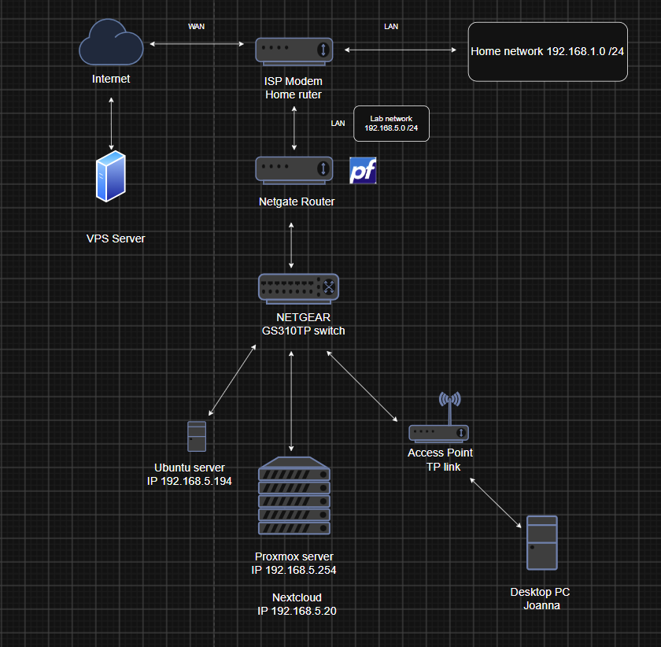

# VM Lab Environment Setup

This project documents the setup of the virtual lab environment used for my cybersecurity projects.

The environment is built using Proxmox and includes an isolated lab network containing attacker, target and monitoring systems.

My work included configuring the virtual lab network, assigning network interfaces and IP addresses to the virtual machines, and verifying connectivity between the systems.

The physical equipment, home network and initial Proxmox installation are hosted and maintained by my colleague [@SiwySec](https://github.com/SiwySec). Remote access and lab isolation were configured in collaboration.

## Lab Access

- Remote access to the lab network is provided through a WireGuard VPN tunnel configured with public-key authentication.
- The physical Proxmox host is started on demand using Wake-on-LAN from pfSense.
- Sensitive details such as MAC addresses and system information are removed from the documentation.

## Isolated Lab Network (LAB-LAN)

A dedicated Proxmox virtual bridge, `vmbr2`, was created for the SOC lab. The existing bridges (`vmbr0` and `vmbr1`) are used for Proxmox and home network connectivity. All lab VMs were grouped into a dedicated Proxmox resource pool.

| VM | Role | IP in LAB-LAN |
|---|---|---|
| Ubuntu Server – Splunk | Splunk Enterprise / SIEM | 192.168.50.10 |
| Windows 10 | Target + Universal Forwarder | 192.168.50.20 |
| Ubuntu VM | Target + Universal Forwarder | 192.168.50.30 |
| Windows Server 2022 | Target + Universal Forwarder | 192.168.50.40 |
| Metasploitable | Vulnerable target | 192.168.50.50 |
| Kali Linux | Attacker | 192.168.50.100 |

### Network design decisions

- **Metasploitable** is connected only to `vmbr2`, with no Internet access, because it is intentionally vulnerable.
- **Kali Linux** has two network adapters: one on `vmbr2` for lab activity and one on `vmbr0` for Internet access (tool updates).
- Static IP addresses were assigned to every VM according to the address scheme above. On Windows Server 2022, PowerShell was used instead of the GUI to save resources.
- Connectivity between all lab systems was verified before any Splunk or attack work started.

## Documentation

Full step-by-step documentation of the lab environment setup is available below:

[VM Lab Environment Setup – Full Documentation](./VM%20Lab%20Environment%20Setup.pdf)

## Current Lab Topology

The diagram below shows the current lab architecture. The environment has continued to develop since the original setup documentation was created, including the integration of a public-facing VPS used for security monitoring.

